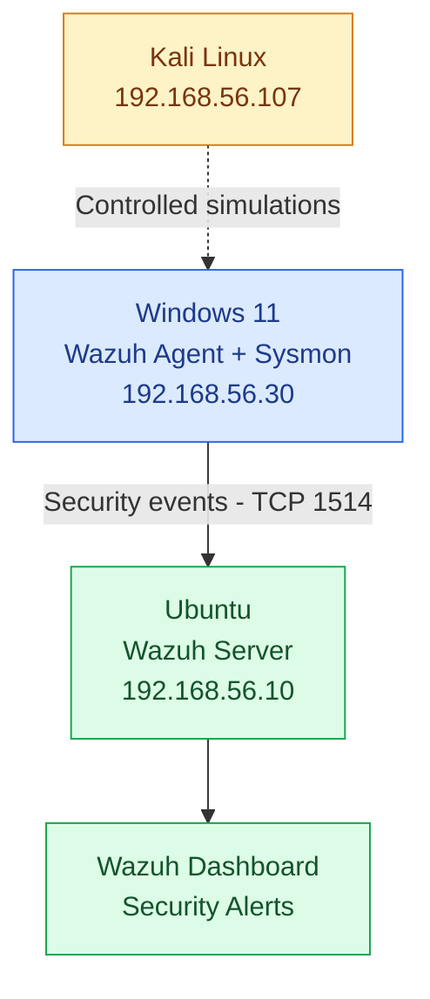

# Network Architecture — Wazuh SOC Home Lab

## 1. Overview

This project implements a virtualized Security Operations Center (SOC) home laboratory using Oracle VirtualBox.

The environment consists of three virtual machines connected through an isolated Host-Only network, with separate NAT interfaces for outbound network access.

The laboratory is designed to support Windows security monitoring, centralized log collection, custom detection rules, and controlled security simulations.

## 2. Virtual Machines

| Virtual Machine | Operating System | Role | Host-Only IP |

|---|---|---|---|

| Wazuh Server | Ubuntu 24.04 | SIEM server and security monitoring | 192.168.56.10 |

| Windows Endpoint | Windows 11 | Monitored endpoint with Wazuh Agent and Sysmon | 192.168.56.30 |

| Kali Linux | Kali Linux | Security testing workstation | 192.168.56.107 |

## 3. Network Configuration

**Hypervisor:** Oracle VirtualBox

**Host-Only network:** `192.168.56.0/24`

Each virtual machine has two network interfaces:

- **NAT:** Provides outbound network access through VirtualBox.

- **Host-Only Adapter:** Enables communication between the laboratory machines and the host system.

### IP Addressing

| Machine | NAT IP | Host-Only IP |

|---|---|---|

| Wazuh Server | 10.0.2.15 | 192.168.56.10 |

| Windows Endpoint | 10.0.2.15 | 192.168.56.30 |

| Kali Linux | 10.0.2.15 | 192.168.56.107 |

The identical NAT addresses are expected because each VM uses an independent VirtualBox NAT environment.

Internal laboratory communication uses the Host-Only addresses.

## 4. Security Monitoring Architecture

### Wazuh Server

The Ubuntu virtual machine hosts the Wazuh SIEM infrastructure.

Its responsibilities include:

- Receiving security events from monitored endpoints.

- Processing events through Wazuh detection rules.

- Generating security alerts.

- Providing centralized security monitoring and investigation capabilities.

### Windows Endpoint

The Windows 11 virtual machine is monitored using:

- **Wazuh Agent:** Collects and forwards configured security events.

- **Sysmon:** Generates detailed Windows system activity events.

- **Windows Event Logs:** Provide operating system and security auditing information.

- **File Integrity Monitoring (FIM):** Monitors changes to selected files and directories.

Configured event sources include:

- Windows Security

- Windows System

- Windows Application

- Sysmon Operational

- PowerShell Operational

- Task Scheduler Operational

The Wazuh Agent is configured to communicate with the Wazuh Server at `192.168.56.10` over TCP port `1514`.

### Kali Linux

Kali Linux serves as a dedicated security testing workstation within the laboratory.

It is intended for authorized, controlled security simulations against laboratory systems.

## 5. Security Event Flow

## 6. Network Isolation

The Host-Only network provides a dedicated communication segment for the laboratory.

The NAT adapters provide outbound connectivity without directly exposing the virtual machines as services on the physical LAN.

Security simulations are restricted to authorized laboratory systems.

Host-Only networking does not, by itself, guarantee complete isolation from the host or from outbound connections through NAT.

## 7. Configuration Files

The following configuration files are maintained in this repository:

- `configs/sysmon/sysmon-config.xml` — Sysmon event collection configuration.

- `configs/windows/ossec.conf` — Windows Wazuh Agent configuration.

- `rules/soc_lab_rules.xml` — Custom Wazuh detection rules.

These files document the security monitoring configuration used in the laboratory.

