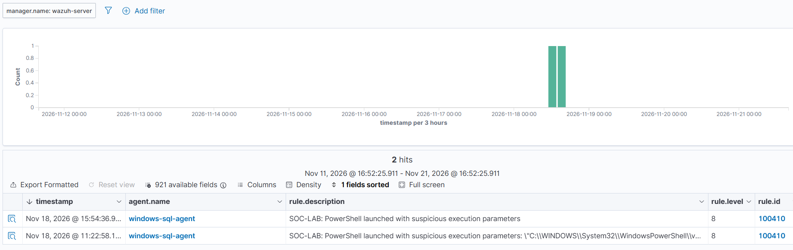
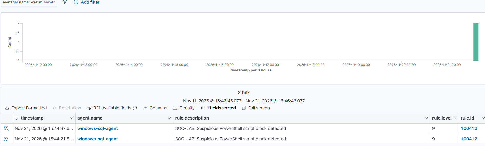

# Scenario 01 — Suspicious PowerShell Execution

## Objective

Detect potentially suspicious PowerShell activity using Sysmon process creation events and PowerShell Script Block Logging.

## Detection Coverage

| Rule ID | Level | Detection |
|---|---|---|
| 100410 | 8 | Suspicious PowerShell execution parameters |
| 100411 | 10 | PowerShell download-and-execute indicators |
| 100412 | 9 | Suspicious PowerShell script block |

## Telemetry Sources

| Source | Event ID | Description |
|---|---|---|
| Sysmon | 1 | Process creation and command-line arguments |
| PowerShell Operational | 4104 | Script block execution content |

## MITRE ATT&CK

**Technique:** T1059.001 — Command and Scripting Interpreter: PowerShell

**Tactic:** Execution

## Detection Workflow

1. PowerShell activity occurs on the Windows endpoint.
2. Sysmon or PowerShell logging records the relevant activity.
3. The Wazuh Agent forwards collected events to the Wazuh Server.
4. Wazuh evaluates the events against the configured detection rules.
5. Matching events generate security alerts for investigation.

## Validation Results

The following custom detection rules generated alerts in the Wazuh Dashboard during controlled laboratory testing.

| Rule ID | Severity | Observed Results | Validation |
|---|---|---|---|
| 100410 | Level 8 | 1 alert ? November 18, 2026 | Confirmed |
| 100411 | Level 10 | Not demonstrated by the screenshots below | Not evidenced here |
| 100412 | Level 9 | 2 alerts ? November 21, 2026 | Confirmed |

**Monitored endpoint:** `windows-sql-agent`

These observations confirm that Wazuh generated alerts for suspicious PowerShell execution parameters and suspicious script block activity.

## Screenshots

### Rule 100410 ? Suspicious PowerShell Execution Parameters

### Rule 100412 ? Suspicious PowerShell Script Block

## Detection Rules

See [Custom Wazuh Rules](../rules/soc_lab_rules.xml).
