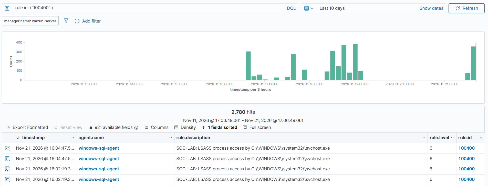
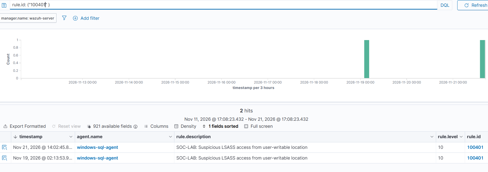

# Scenario 02 - LSASS Process Access Detection

## Objective

Monitor access to the Windows Local Security Authority Subsystem Service (LSASS) process and identify potentially suspicious access originating from user-writable locations.

LSASS is a security-sensitive Windows process. Unauthorized access to its memory may indicate credential dumping attempts.

## Detection Coverage

| Rule ID | Level | Detection | Result |
|---|---|---|---|
| 100400 | 6 | LSASS process access monitoring | Alerts observed |
| 100401 | 10 | Suspicious LSASS access from a user-writable location | 2 alerts detected |

## Telemetry Source

| Component | Details |
|---|---|
| Endpoint | Windows 11 |
| Monitoring tool | Sysmon |
| Event ID | 10 - ProcessAccess |
| SIEM | Wazuh |
| Monitored agent | windows-sql-agent |

## MITRE ATT&CK

**Technique:** T1003.001 - OS Credential Dumping: LSASS Memory

**Tactic:** Credential Access

This technique is relevant to suspicious LSASS access. An access event alone does not establish that credential dumping occurred.

## Detection Workflow

1. A process accesses LSASS on the monitored Windows endpoint.
2. Sysmon records the activity through Event ID 10.
3. The Wazuh Agent forwards the event to the Wazuh Server.
4. Custom detection rules evaluate the process access.
5. Matching events generate alerts for security investigation.

## Validation Results

The Wazuh Dashboard confirmed LSASS access monitoring through rule 100400 and two suspicious-access alerts through rule 100401.

The general monitoring rule also captures legitimate Windows process activity, including access by svchost.exe. These events require contextual analysis and should not automatically be classified as attacks.

## Screenshots

### Rule 100400 - LSASS Process Access Monitoring

### Rule 100401 - Suspicious LSASS Access

## Detection Rules

See [Custom Wazuh Rules](../rules/soc_lab_rules.xml).
