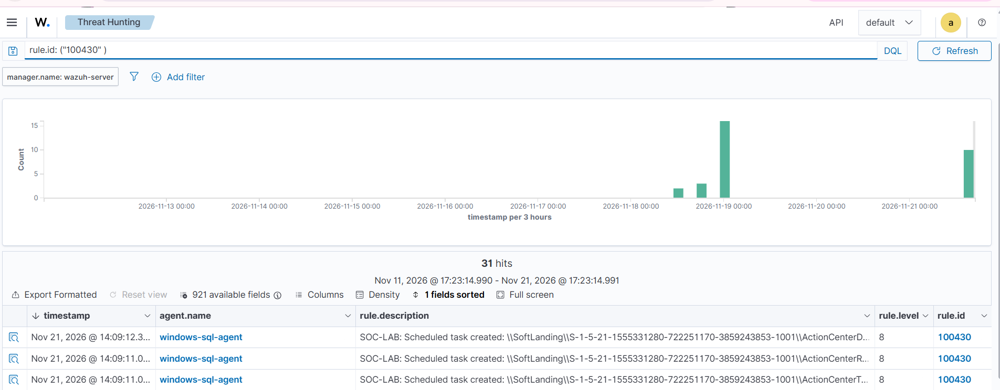
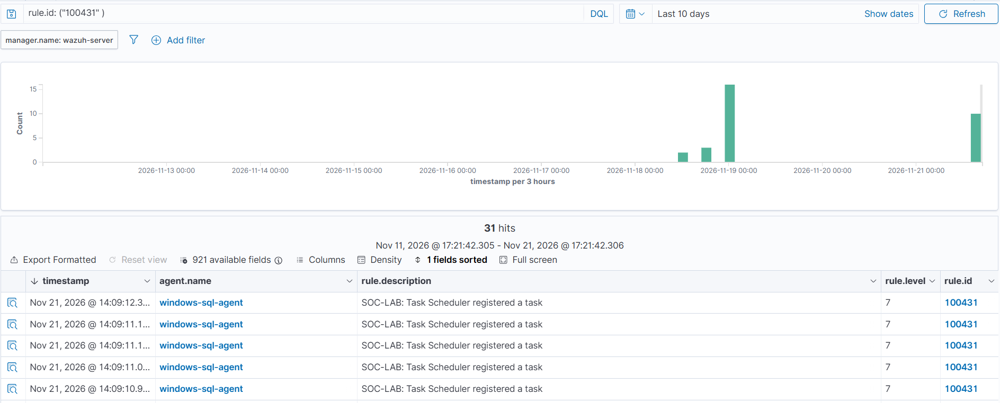

# Scenario 03 - Scheduled Task Creation Detection

## Objective

Detect the creation and registration of Windows scheduled tasks using Windows security auditing and Task Scheduler events.

Scheduled tasks are commonly used for legitimate system administration and software maintenance. However, attackers may also abuse this mechanism to execute programs or establish persistence.

## Detection Coverage

| Rule ID | Level | Detection |
|---|---|---|
| 100430 | 8 | Windows scheduled task creation |
| 100431 | 7 | Task Scheduler task registration |

## MITRE ATT&CK

**Technique:** T1053.005 - Scheduled Task/Job: Scheduled Task

**Tactics:** Execution, Persistence, Privilege Escalation

## Detection Workflow

1. A scheduled task is created or registered on the Windows endpoint.
2. Windows Security Event ID 4698 or Task Scheduler Event ID 106 records the activity.
3. The Wazuh Agent forwards the event to the Wazuh Server.
4. Custom detection rules identify the task creation or registration.
5. Wazuh generates an alert for security monitoring and investigation.

## Validation Results

Both custom detection rules generated alerts in the Wazuh Dashboard.

- Rule 100430 detected Windows scheduled task creation events.
- Rule 100431 detected task registration events reported by Task Scheduler.

The observed events included legitimate Windows and application tasks. These alerts demonstrate monitoring coverage and do not, by themselves, indicate malicious persistence.

## Screenshots

### Rule 100430 - Scheduled Task Creation

### Rule 100431 - Task Registration

## Detection Rules

See [Custom Wazuh Rules](../rules/soc_lab_rules.xml).
