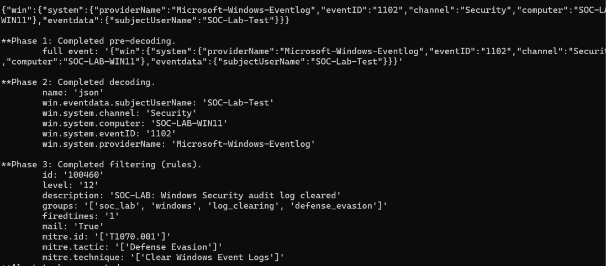
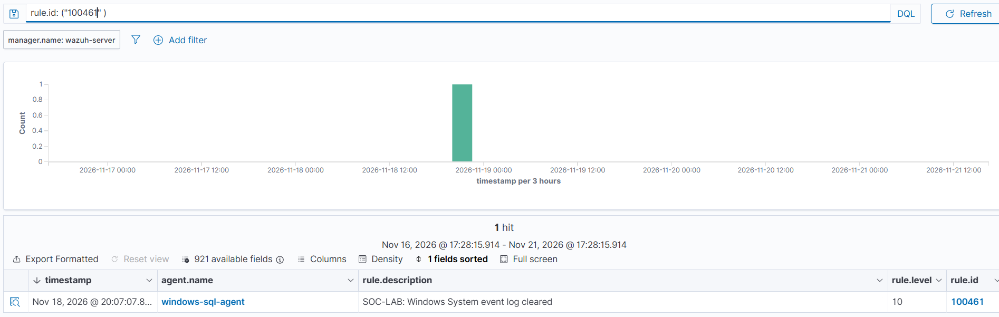

# Scenario 04 - Windows Event Log Clearing Detection

## Objective

Detect the clearing of Windows event logs, an activity that may be associated with attempts to remove evidence of system activity.

Windows event log clearing can be performed for legitimate administrative purposes, but it may also indicate defense evasion.

## Detection Coverage

| Rule ID | Level | Detection |
|---|---|---|
| 100460 | 12 | Windows Security audit log clearing |
| 100461 | 10 | Windows System event log clearing |

## MITRE ATT&CK

**Technique:** T1070.001 - Indicator Removal: Clear Windows Event Logs

**Tactic:** Defense Evasion

## Detection Workflow

1. A Windows event log clearing event is generated or simulated.
2. The event contains the relevant Windows Event ID.
3. Wazuh evaluates the event against the custom detection rules.
4. A matching event triggers the corresponding detection rule.
5. The detection result is reviewed to verify the rule behavior.

## Validation Results

Two complementary validation methods were used.

| Rule ID | Validation Method | Evidence |
|---|---|---|
| 100460 | Wazuh logtest | Rule matched the simulated Security Event ID 1102 |
| 100461 | Wazuh Dashboard | Alert generated for System Event ID 104 |

Rule 100460 was validated using a simulated event processed by the Wazuh rule engine. This confirms rule matching but does not demonstrate end-to-end Windows event collection.

Rule 100461 was observed in the Wazuh Dashboard, confirming that the monitored Windows endpoint generated an event that was collected and detected by Wazuh.

## Screenshots

### Rule 100460 - Security Log Clearing (Logtest)

### Rule 100461 - System Log Clearing (Dashboard)

## Detection Rules

See [Custom Wazuh Rules](../rules/soc_lab_rules.xml).
