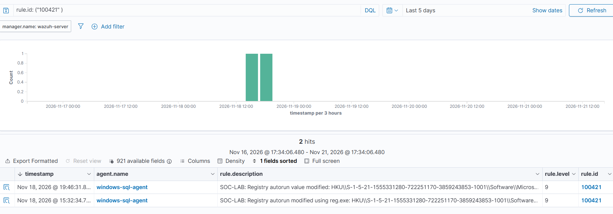

# Scenario 05 - Registry Persistence Detection

## Objective

Detect modifications to Windows Registry autorun entries that may be used to establish persistence.

Windows Run and RunOnce registry keys allow programs to execute automatically when a user signs in. Although commonly used by legitimate applications, these mechanisms may also be abused by attackers.

## Detection Coverage

| Rule ID | Level | Detection |
|---|---|---|
| 100421 | 9 | Registry autorun value modification |

## MITRE ATT&CK

**Technique:** T1547.001 - Boot or Logon Autostart Execution: Registry Run Keys / Startup Folder

**Tactic:** Persistence

## Detection Workflow

1. A Windows Registry autorun value is modified.
2. Sysmon records the registry modification event.
3. The Wazuh Agent forwards the event to the Wazuh Server.
4. The custom detection rule identifies the monitored registry activity.
5. Wazuh generates an alert for investigation.

## Validation Results

The Wazuh Dashboard recorded two alerts for rule 100421 on the monitored Windows endpoint.

The observed events included a registry autorun modification associated with reg.exe.

These results demonstrate the detection of registry autorun modifications. They do not, by themselves, establish that malicious persistence was achieved.

## Screenshot

### Rule 100421 - Registry Autorun Modification

## Detection Rules

See [Custom Wazuh Rules](../rules/soc_lab_rules.xml).
