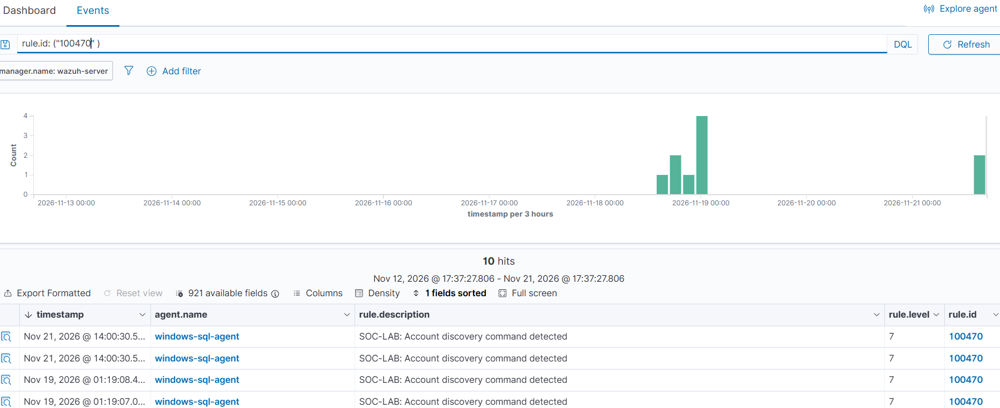

# Scenario 06 - System Reconnaissance Detection

## Objective

Detect Windows account discovery commands that may be used during system reconnaissance.

Account discovery allows users or attackers to identify local accounts and gather information about the target environment. Although these commands are also used for legitimate administration, their execution may warrant investigation.

## Detection Coverage

| Rule ID | Level | Detection |
|---|---|---|
| 100470 | 7 | Windows account discovery command execution |

## MITRE ATT&CK

**Technique:** T1087.001 - Account Discovery: Local Account

**Tactic:** Discovery

## Detection Workflow

1. An account discovery command is executed on the Windows endpoint.
2. Sysmon records the process creation event (Event ID 1).
3. The Wazuh Agent forwards the event to the Wazuh Server.
4. The custom detection rule identifies the account discovery activity.
5. Wazuh generates an alert for security investigation.

## Validation Results

The Wazuh Dashboard recorded 10 alerts for rule 100470 on the monitored Windows endpoint.

These results confirm that the configured detection rule identified account discovery activity and generated corresponding security alerts.

The detection of an account discovery command does not, by itself, establish malicious intent.

## Screenshot

### Rule 100470 - Account Discovery Detection

## Detection Rules

See [Custom Wazuh Rules](../rules/soc_lab_rules.xml).
