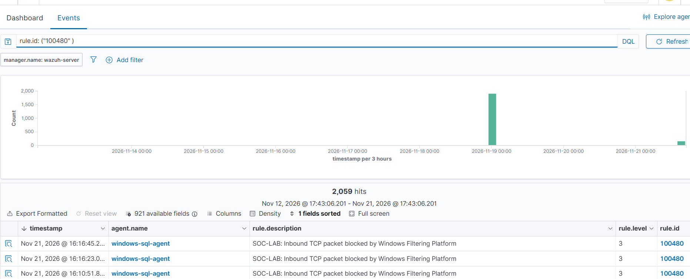
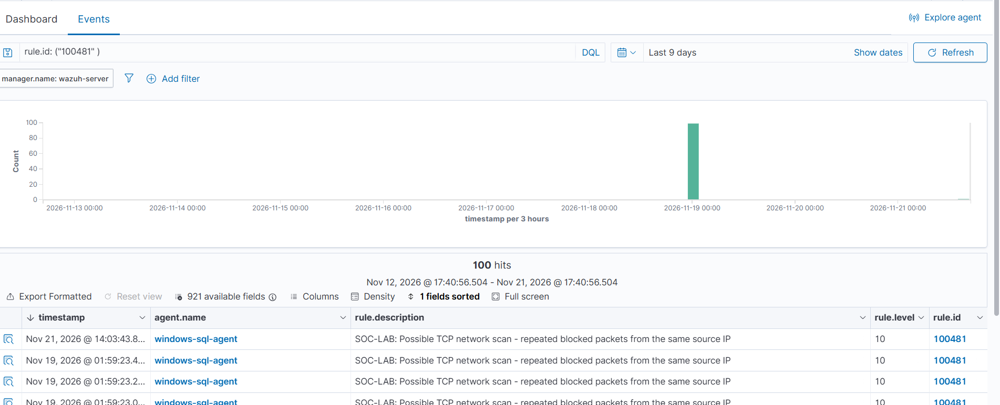

# Scenario 07 - Network Scanning Detection

## Objective

Detect inbound TCP connections blocked by Windows Filtering Platform and identify repeated blocked connection attempts that may indicate network scanning activity.

Network scanning is commonly used to discover accessible services and open ports. Although it can be part of authorized security assessments, similar activity may also occur during malicious reconnaissance.

## Detection Coverage

| Rule ID | Level | Detection |
|---|---|---|
| 100480 | 3 | Inbound TCP packets blocked by Windows Filtering Platform |
| 100481 | 10 | Possible TCP network scan based on repeated blocked packets |

## MITRE ATT&CK

**Technique:** T1046 - Network Service Discovery

**Tactic:** Discovery

The MITRE mapping applies to rule 100481, which identifies patterns consistent with possible network scanning.

## Detection Workflow

1. TCP connection attempts reach the Windows endpoint.
2. Windows Filtering Platform blocks the incoming packets.
3. The Wazuh Agent collects the relevant Windows security events.
4. Rule 100480 identifies individual blocked TCP packets.
5. Rule 100481 detects repeated blocked packets from the same source IP within a defined time window.
6. Wazuh generates alerts for security investigation.

## Validation Results

The Wazuh Dashboard recorded the following alerts during laboratory monitoring:

| Rule ID | Alerts Observed |
|---|---|
| 100480 | 2,059 |
| 100481 | 100 |

These observations confirm that Wazuh generated alerts for blocked inbound TCP traffic and repeated blocked connection attempts.

The alerts indicate potential scanning behavior but do not, by themselves, establish malicious intent.

## Screenshots

### Rule 100480 - Blocked Inbound TCP Packets

### Rule 100481 - Possible TCP Network Scan

## Detection Rules

See [Custom Wazuh Rules](../rules/soc_lab_rules.xml).
